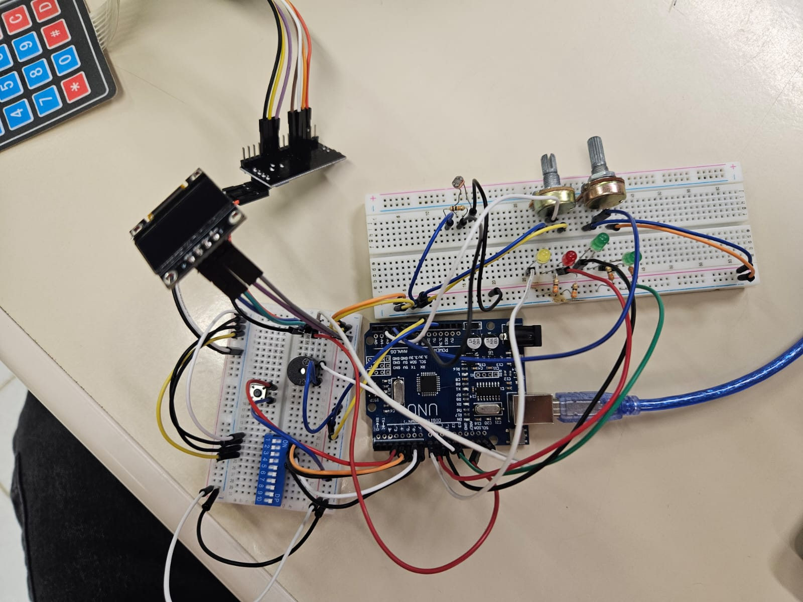
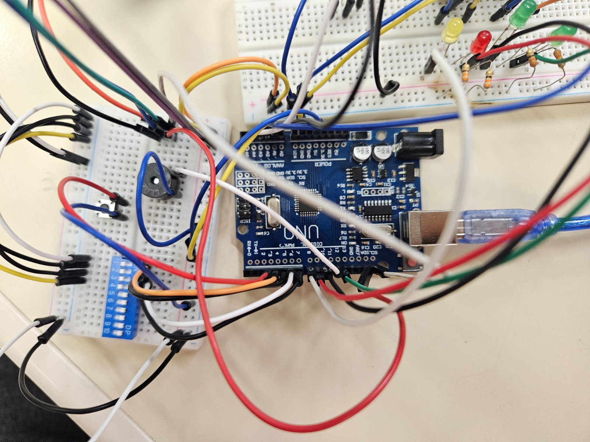

# Bomb Game

Jogo interativo de **desarmamento de uma bomba fictícia**, desenvolvido como projeto acadêmico da disciplina de **Microcontroladores**. O sistema utiliza um **Arduino Uno (ATmega328P)**, sensores, chaves, potenciômetros, LEDs, display OLED e teclado para apresentar quatro desafios consecutivos.

O projeto foi programado em **C/C++**, utilizando **Visual Studio Code + PlatformIO**, e explora conceitos como acesso direto aos registradores do microcontrolador, interrupções, temporizadores, conversão analógico-digital e comunicação I²C.

> **Status:** protótipo montado e fases integradas. O código ainda está em revisão final; alguns detalhes podem ser atualizados após os últimos testes.

## Montagem do protótipo

**Visão geral do protótipo:** Arduino Uno conectado às duas protoboards, OLED, teclado, potenciômetros, chaves e demais componentes.



**Detalhe do circuito:** conexões do Arduino Uno, buzzer, chaves e LEDs.



As fotos registram a montagem do protótipo em protoboards. Para reproduzi-la, consulte também a tabela de conexões abaixo: as imagens não substituem um esquema elétrico completo.

## Funcionamento do jogo

A proposta é que um **operador**, responsável pelo circuito, siga as orientações de um **especialista**, responsável por consultar o manual de desarmamento.

- **Tempo inicial:** 480 segundos (8 minutos).
- **Penalidade:** cada erro reduz o tempo restante em 15 segundos.
- **Limite de erros:** o terceiro erro encerra a partida.
- **Vitória:** concluir as quatro fases dentro do tempo disponível.
- **Derrota:** esgotamento do tempo ou registro de três erros.
- **Sinalização sonora:** indicação de erros, alertas de tempo, vitória e derrota por meio de um buzzer.

### As quatro fases

| Fase | Desafio | Componentes principais |
| --- | --- | --- |
| **1 — Sistema de Chaves** | Interpretar o identificador mostrado no OLED, posicionar corretamente as chaves e confirmar a seleção. | Chaves DIP, botão, OLED |
| **2 — Painel de Calibração** | Interpretar os estados dos LEDs e ajustar os dois potenciômetros conforme as instruções. Cada tentativa tem limite de 60 segundos. | 3 LEDs e 2 potenciômetros |
| **3 — Protocolo de Emergência** | Executar uma sequência de ações de luminosidade e digitação, definida por protocolo, código e condição inicial sorteados. | LDR, teclado e OLED |
| **4 — Sequência de Segurança** | Observar uma sequência de quatro LEDs, determinar o código de seis dígitos correspondente e digitá-lo. | 4 LEDs e teclado |

## Manual de Desarmamento

O **Manual de Desarmamento** contém as instruções que o especialista utiliza para orientar o operador durante as quatro fases. O README documenta a montagem, o funcionamento e a implementação técnica do projeto; o manual reúne as regras necessárias para resolver os desafios.

- 📖 **[Consultar o Manual de Desarmamento (PDF)](tutorial/Manual_Bomb_Game.pdf)** — versão para leitura e impressão.
- 📝 **[Baixar o Manual de Desarmamento (Word)](tutorial/Manual_Bomb_Game.docx)** — versão editável.

Ambos os arquivos estão disponíveis na pasta `tutorial/`.


## Componentes utilizados

| Quantidade | Componente | Aplicação |
| ---: | --- | --- |
| 1 | Arduino Uno (ATmega328P) | Controle central |
| 1 | Display OLED SSD1306 128 × 64, I²C | Interface visual |
| 1 | Teclado matricial físico 4 × 4 | Entrada de comandos; o código utiliza somente as 3 colunas numéricas (`0`–`9`, `*`, `#`) |
| 1 | Módulo expansor PCF8574T | Interface I²C com o teclado |
| 1 | Conjunto de chaves DIP | Seleção de chaves na fase 1; quatro posições são utilizadas |
| 1 | Botão de pressão | Confirmação na fase 1 |
| 1 | LDR | Detecção de luminosidade na fase 3 |
| 2 | Potenciômetros | Ajustes na fase 2 |
| 4 | LEDs | Sinalização nas fases 2 e 4; três são compartilhados |
| 1 | Buzzer | Sinalização sonora |
| 4 | Resistores de 330 Ω | Limitação de corrente dos LEDs |
| 1 | Resistor de 10 kΩ | Circuito de leitura do LDR |
| — | Protoboards, jumpers e cabo USB | Montagem, conexão e alimentação |

## Conexões com o Arduino Uno

| Pino do Arduino | Conexão | Observações |
| --- | --- | --- |
| **D3** | Botão de confirmação | Interrupção externa `INT1`; entrada com pull-up interno |
| **D4–D7** | Quatro chaves | Entradas digitais com pull-up interno |
| **D8** | LED 1 da fase 4 | `PB0` |
| **D9** | LED 2 da fase 4 / LED amarelo da fase 2 | `PB1` |
| **D10** | LED 3 da fase 4 / LED azul da fase 2 | `PB2` |
| **D11** | Buzzer | `PB3` |
| **D12** | LED 4 da fase 4 / LED verde da fase 2 | `PB4` |
| **A1** | LDR | Canal ADC1; resistor de 10 kΩ no circuito de leitura |
| **A2** | Potenciômetro 1 | Canal ADC2 |
| **A3** | Potenciômetro 2 | Canal ADC3 |
| **A4 (SDA)** | Barramento I²C | Compartilhado pelo OLED e PCF8574T |
| **A5 (SCL)** | Barramento I²C | Compartilhado pelo OLED e PCF8574T |

**Importante:** os LEDs das fases 2 e 4 compartilham os pinos **D9, D10 e D12**; o LED de D8 é usado na fase 4. Conecte todos os módulos ao GND comum e respeite a alimentação e a polaridade dos componentes. Confira os valores e a posição dos resistores antes de energizar a montagem.

### Dispositivos I²C e teclado

| Dispositivo | Endereço I²C |
| --- | --- |
| OLED SSD1306 | `0x3C` |
| Expansor PCF8574T | `0x27` |

O teclado físico possui quatro colunas, mas o software utiliza apenas **três** delas. As teclas `A`, `B`, `C` e `D` não participam do jogo. O mapeamento lógico do PCF8574T é:

- **Linhas:** P0, P1, P2 e P4.
- **Colunas:** P5, P6 e P7.

A leitura do teclado é feita por funções próprias que acessam o PCF8574T via `Wire`.

## Software e recursos do ATmega328P

O programa é organizado por uma **máquina de estados**:

```text
INICIO → FASE_1 → FASE_2 → FASE_3 → FASE_4 → VITORIA
             └── GAME_OVER (tempo esgotado ou 3 erros)
```

A condição de `GAME_OVER` pode ocorrer durante qualquer fase. Depois de `VITORIA` ou `GAME_OVER`, é possível reiniciar o jogo.

Principais recursos implementados:

- **Timer1**, configurado para interrupções periódicas de 1 ms, utilizado pela contagem personalizada `meu_millis()` e pela geração do sinal do buzzer.
- **Timer2**, utilizado na contagem regressiva de 480 segundos.
- **Interrupção externa INT1**, acionada pelo botão de confirmação da primeira fase.
- **ADC**, utilizado para ler o LDR e os dois potenciômetros por meio de `meu_analogRead()`.
- **I²C (`Wire`)**, utilizado para controlar o display OLED e o expansor PCF8574T.
- **Acesso direto a registradores**, incluindo `DDRx`, `PORTx`, `PINx`, `ADCSRA` e registradores de temporizadores/interrupções.
- **Controle de estados e temporização**, utilizando contadores, flags, validação de tempo e atualização periódica do display.

**Nota de desenvolvimento:** a maior parte das etapas utiliza temporização por contadores, mas a versão de código analisada ainda contém uma espera de 2 segundos com `delay()` na entrada da fase 4. Esse comportamento deverá ser reavaliado na revisão final.

## Como compilar e executar

### Requisitos

- Arduino Uno e circuito montado.
- Visual Studio Code com a extensão **PlatformIO IDE**.
- Cabo USB compatível com a placa.

### Configuração do PlatformIO

Arquivo `platformio.ini`:

```ini
[env:uno]
platform = atmelavr
board = uno
framework = arduino
monitor_speed = 9600
lib_deps =
  adafruit/Adafruit GFX Library @ ^1.11.9
  adafruit/Adafruit SSD1306 @ ^2.5.9
  Keypad
```

A biblioteca `Keypad` permanece declarada na configuração, embora a versão atual do `main.cpp` faça a leitura do teclado diretamente pelo PCF8574T.

### Execução

1. Abra a pasta do projeto no VS Code.
2. Aguarde o PlatformIO preparar o ambiente e as dependências.
3. Conecte o Arduino Uno ao computador por USB.
4. Utilize **Build** para compilar e **Upload** para enviar o programa à placa.
5. No OLED, pressione **`#`** para iniciar a partida.
6. Resolva as quatro fases com auxílio do manual de desarmamento.
7. Se quiser acompanhar as mensagens de depuração, abra o **Serial Monitor** a **9600 baud**.

### Comandos importantes

| Comando | Ação |
| --- | --- |
| `#` na tela inicial | Iniciar a partida |
| `#` na fase 3 | Iniciar o protocolo de emergência |
| `*` na fase 4 | Reproduzir mais uma vez a sequência de LEDs (somente uma repetição) |
| `#` na fase 4 | Limpar os dígitos digitados |
| `*` após vitória ou derrota | Reiniciar o jogo |
| `R` ou `r` no Serial Monitor após vitória ou derrota | Reiniciar o jogo |

## Organização do repositório

```text
Mic_project/
├── src/
│   └── main.cpp              # Código principal
├── tutorial/                  # Documentação e manual de desarmamento
│   ├── Manual_Bomb_Game.pdf     # Manual para consulta
│   ├── Manual_Bomb_Game.docx    # Manual editável
│   └── imagens/                # Fotos da montagem
├── platformio.ini             # Configuração do ambiente PlatformIO
└── README.md                  # Documentação geral do projeto
```

Os links acima utilizam caminhos relativos, permitindo acessar o manual diretamente pelo README do repositório no GitHub.

## Autores

- **Leonardo Humeres**
- **Matheus Fertig**
- **Xavier Schmitz**

Projeto acadêmico da disciplina de **Microcontroladores**.
